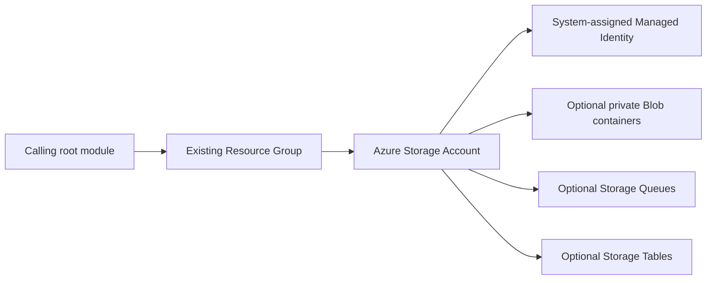

# Terraform Module for Azure Storage Account

Provisions an [Azure Storage Account](https://registry.terraform.io/providers/hashicorp/azurerm/latest/docs/resources/storage_account)
with optional private Blob containers, Storage Queues and Storage Tables,
plus explicit transport, authentication, replication, identity, and public
endpoint firewall controls. Secure defaults enforce TLS 1.2, disable anonymous
blob access, and add a system-assigned managed identity. The caller owns the
resource group, provider configuration, backend, and Terraform state.

## Dependency Graph



## Usage

```hcl
module "storage" {
  source               = "git::https://github.com/f2calv/tf_module_azurerm_storage_account.git//src?ref=0.3.2"
  resource_group_name  = azurerm_resource_group.rg.name
  location             = azurerm_resource_group.rg.location
  storage_account_name = "mystorageaccount"
  tags                 = { environment = "dev" }
}
```

The resource group in this example is created by the calling root module and is
not managed by this module.

### Collection Configuration

Collection support in this checkout is not yet published in release `0.3.2`.
The following development example runs from the root of this checkout; production
callers must pin the immutable release containing these inputs once published.

```hcl
provider "azurerm" {
  features {}
  storage_use_azuread = true
}

module "storage_with_children" {
  source                    = "./src"
  resource_group_name       = azurerm_resource_group.rg.name
  location                  = azurerm_resource_group.rg.location
  storage_account_name      = "examplestorage"
  shared_access_key_enabled = false
  containers                = ["uploads", "archive"]
  queues                    = ["work-items", "work-items-poison"]
  tables                    = ["Documents"]
}
```

The [`containers`, `queues` and `tables` inputs](src/variables.tf) are sets of names,
defaulting to empty. Lists convert to sets, removing duplicates and keeping resource
addresses stable when values are reordered. Containers are always private.
Container and queue names must be 3-63 lowercase letters, digits or single hyphens,
starting and ending with a letter or digit. Special containers such as `$root` and
`$web` are outside this interface. Table names must be 3-63 alphanumeric characters,
start with a letter and be unique without regard to case; `Tables` is reserved.
Queues and tables require a Standard `Storage` or `StorageV2` account; containers
require a Blob-capable account.

The [child-resource outputs](src/outputs.tf) return name-keyed ARM IDs for caller-owned
RBAC, and credential-free container/queue URLs. This module grants no roles.
AzureRM 5.5 uses management APIs for containers and queues, but the table lifecycle
uses the Table data endpoint, including ACL reads/writes. For Entra-only tables,
the caller must configure `storage_use_azuread = true`, provide endpoint connectivity
and grant the deployment identity appropriate table permissions, including ACL
management, such as Storage Table Data Contributor. The account's
`default_to_oauth_authentication` setting only controls the portal default; it does
not select Terraform's authentication method. See
[Table operation permissions](https://learn.microsoft.com/en-us/rest/api/storageservices/authorize-with-azure-active-directory#permissions-for-table-service-operations).

Removing or renaming a collection entry destroys that resource and its data on
apply. These collections do not enable soft delete, versioning or automatic
expiry. Message TTL belongs to each queue producer, not the queue resource.
Review saved plans and arrange independent recovery before destructive changes.

<!-- markdownlint-disable MD033 MD060 -->
<!-- BEGIN_TF_DOCS -->
## Requirements

| Name | Version |
| ---- | ------- |
| terraform | >= 1.2 |
| azurerm | >= 5.5, < 6.0 |

## Providers

| Name | Version |
| ---- | ------- |
| azurerm | >= 5.5, < 6.0 |

## Resources

| Name | Type |
| ---- | ---- |
| [azurerm_storage_account.this](https://registry.terraform.io/providers/hashicorp/azurerm/latest/docs/resources/storage_account) | resource |
| [azurerm_storage_container.this](https://registry.terraform.io/providers/hashicorp/azurerm/latest/docs/resources/storage_container) | resource |
| [azurerm_storage_queue.this](https://registry.terraform.io/providers/hashicorp/azurerm/latest/docs/resources/storage_queue) | resource |
| [azurerm_storage_table.this](https://registry.terraform.io/providers/hashicorp/azurerm/latest/docs/resources/storage_table) | resource |

## Inputs

| Name | Description | Type | Default | Required |
| ---- | ----------- | ---- | ------- | :------: |
| resource\_group\_name | Name of the parent resource group. | `string` | n/a | yes |
| storage\_account\_name | Name of the storage account. | `string` | n/a | yes |
| access\_tier | Storage account access tier (Hot or Cool). | `string` | `"Hot"` | no |
| account\_kind | Storage account kind (StorageV2, BlobStorage, etc.). | `string` | `"StorageV2"` | no |
| account\_replication\_type | Storage account replication type (LRS, GRS, RAGRS, ZRS). | `string` | `"LRS"` | no |
| account\_tier | Storage account tier (Standard or Premium). | `string` | `"Standard"` | no |
| allow\_nested\_items\_to\_be\_public | Whether nested items may be configured for anonymous public access. | `bool` | `false` | no |
| containers | Names of private Blob containers to manage. | `set(string)` | `[]` | no |
| cross\_tenant\_replication\_enabled | Whether object replication may cross Microsoft Entra tenants. | `bool` | `false` | no |
| default\_to\_oauth\_authentication | Whether Azure portal data operations default to OAuth authentication. | `bool` | `false` | no |
| https\_traffic\_only\_enabled | Whether the storage account accepts HTTPS traffic only. | `bool` | `true` | no |
| identity\_type | Managed identity type, or null to omit a managed identity. | `string` | `"SystemAssigned"` | no |
| infrastructure\_encryption\_enabled | Whether a second layer of platform-managed encryption is enabled. | `bool` | `false` | no |
| local\_user\_enabled | Whether local users may access the storage account through SFTP or files. | `bool` | `false` | no |
| location | Location of the parent resource group. | `string` | `"West Europe"` | no |
| min\_tls\_version | Minimum TLS version permitted for storage account requests. | `string` | `"TLS1_2"` | no |
| network\_rules | Public endpoint firewall rules, or null to retain Azure defaults. | ```object({ default_action = string bypass = set(string) ip_rules = set(string) virtual_network_subnet_ids = set(string) })``` | `null` | no |
| public\_network\_access | Public network endpoint state (Enabled or Disabled), or null to use the provider default. | `string` | `null` | no |
| queues | Names of Storage Queues to manage; message TTL is configured by producers. | `set(string)` | `[]` | no |
| shared\_access\_key\_enabled | Whether requests may be authorized with shared access keys. | `bool` | `true` | no |
| tables | Names of Storage Tables to manage. | `set(string)` | `[]` | no |
| tags | Any tags that should be present on the resources. | `map(string)` | `{}` | no |

## Outputs

| Name | Description |
| ---- | ----------- |
| container\_ids | ARM resource IDs of private Blob containers keyed by name. |
| container\_urls | Credential-free Blob container URLs keyed by name. |
| id | The ID of the storage account. |
| location | The location of the storage account. |
| name | The name of the storage account. |
| primary\_access\_key | The primary access key for the storage account. |
| primary\_connection\_string | The primary connection string for the storage account. |
| queue\_ids | ARM resource IDs of Storage Queues keyed by name. |
| queue\_urls | Credential-free Storage Queue URLs keyed by name. |
| table\_ids | ARM resource IDs of Storage Tables keyed by name. |
<!-- END_TF_DOCS -->
<!-- markdownlint-enable MD033 MD060 -->

## Development

Regenerate the Terraform reference after changing resources, variables,
outputs, or version constraints:

```bash
terraform-docs --config .terraform-docs.yml src
```

The pre-commit configuration runs the same command in CI and fails when
generated documentation is not committed.

With Terraform `1.16.2`, run the credential-free mock tests:

```bash
terraform -chdir=src init -backend=false
terraform -chdir=src test
```

Mocks check configuration, validation and output contracts; they do not establish
live Azure authorization, keyless table access or data recoverability.
